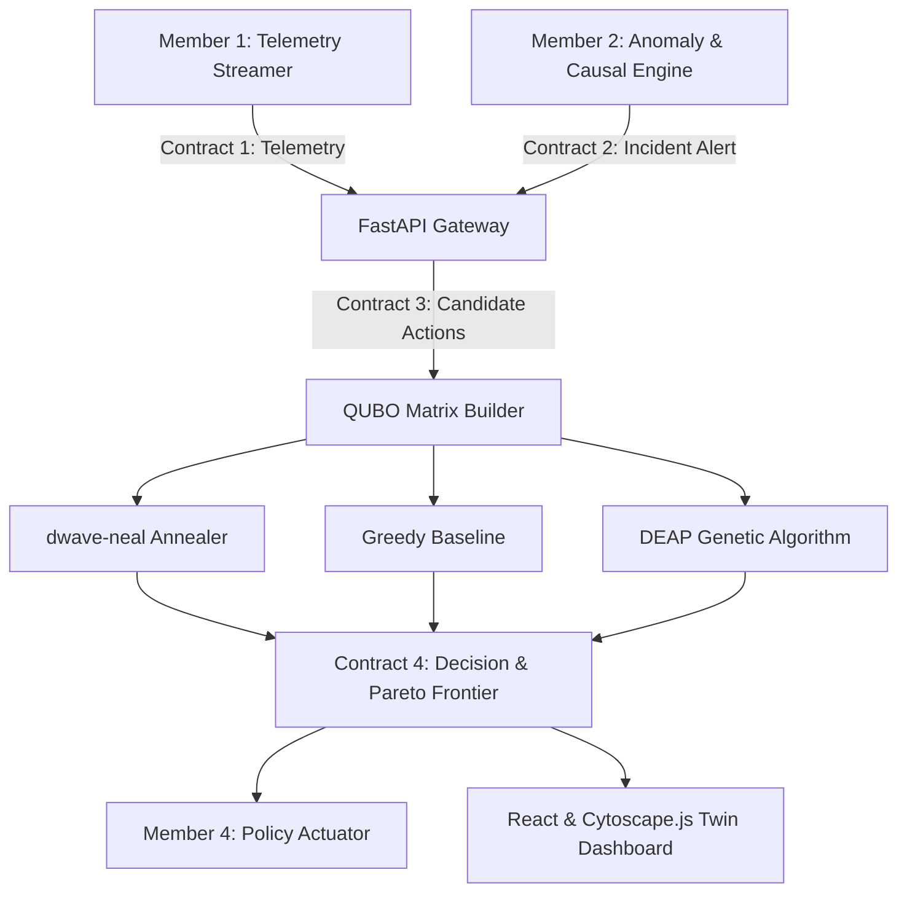

# Self-Healing Network (Member 3: Optimizer & Dashboard)

An autonomous, quantum-inspired self-healing networking platform combining:
- **QUBO Optimization**: Formulated with pairwise conflict penalties, blast-radius dampening, and cardinality enforcement.
- **Multi-Solver Engine**: Quantum-Inspired Simulated Annealing (`dwave-neal`, `openjij`), Greedy heuristic baseline, and Genetic Algorithm baseline (`DEAP`).
- **Real-Time Digital Twin Dashboard**: React 18, Cytoscape.js topology canvas, dynamic link utilization styling, ghost overlay preview, and Recharts Pareto trade-off curves.
- **FastAPI Gateway**: High-throughput REST API implementing frozen inter-module data contracts (Contracts 1–4).

---

## 🏗 Architecture Overview



---

## 🚀 Quickstart

### 1. Backend Setup
```bash
# Activate virtual environment
.venv\Scripts\activate   # Windows
# or: source .venv/bin/activate # Linux/macOS

# Install dependencies
pip install -r backend/requirements.txt

# Start FastAPI Gateway
python backend/main.py
# Running on http://127.0.0.1:8001 (auto-detects and uses 8000 if free, or 8001 if occupied)
```

Interactive API documentation is accessible at: [http://127.0.0.1:8001/docs](http://127.0.0.1:8001/docs)

### 2. Frontend Setup
```bash
cd frontend
npm install
npm run dev
# Running on http://localhost:5173 (or next free port)
```

### 3. Master Orchestrator Pipeline Stub
Run the end-to-end integration pipeline:
```bash
python orchestrator.py
```

### 4. Scalability Benchmark
Run scaling benchmark across 10, 50, 200, and 500 variables:
```bash
python backend/optimizer/benchmark.py
```

### 5. Automated End-to-End Test Suite
Verify the full incident-optimization-healing cycle:
```bash
python tests/test_e2e.py
```

---

## 📑 Inter-Module Data Contracts

Refer to [`contracts.md`](contracts.md) for full JSON schemas:
- **Contract 1:** `/api/telemetry` — Link state (`util`, `latency`, `loss`, `capacity_mbps`) & flows.
- **Contract 2:** `/api/incident` — Root-cause diagnostics, anomalous links, and causal chains.
- **Contract 3:** `/api/candidate-actions` — Candidate actions (`cost`, `blast_radius`, `params`).
- **Contract 4:** `/api/optimize` — Remediation plan, ghost predicted state, confidence, and multi-solver comparative benchmark metrics.
